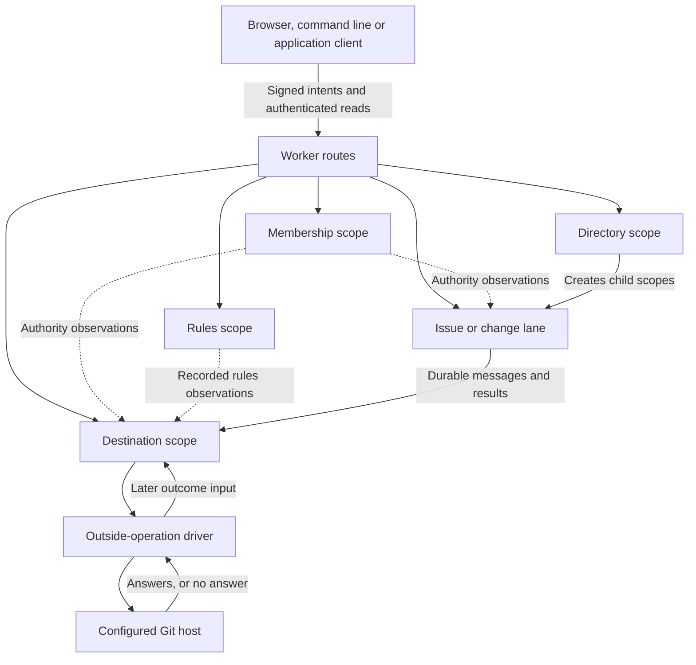

# The architecture of a dap application

This page explains how a dap application decides what happened, where it
keeps the record, and how someone else can check it. It follows the
logical parts first and ends with how they are deployed today. For the
full contract of each part, read [Scopes](scopes.md).

![The dap model. A person or an agent signs an act and sends it over the command line, MCP or HTTP. A scope judges it against its pinned definition, with guards, rule expressions in a restricted JSONata, and the signer's grants. An act that takes effect becomes an entry in the journal, and its declared effects are folded into the scope's items. The journal can be replayed, entries send messages to other scopes, and a destination scope publishes the files it is sent to a Git repository on Cloudflare Artifacts or GitHub, which serves pages. Dashed lines are planned.](assets/dap-architecture.svg)

The diagram shows the intended model. Two parts of it are planned and not
yet built, and are drawn dashed: writing items to the repository, and the
archive of the journal in Git. Today a destination scope publishes to the
repository a room's merged changes, as "How it is deployed today"
describes, and the files that an application's acts send it, such as the
lending library's shelf pages. A refused act gets a reason and the head
at which it was judged.

## A scope is an actor with one definition

Every part of a dap application is a scope. A scope has an ID, a journal
of entries and a set of items. It pins one definition by digest in its
first entry, the genesis, and is judged by that definition for as long as
it exists.

A definition is a JSON value, not code. It declares:

- item types, with their states, initial state and slots for members,
  references and values.
- acts, each with its fields, the action a signer must be allowed to
  take, its guards, its effects and its sends.
- handlers for messages from other scopes.
- timed rules, which apply when a deadline held in an item passes.
- rule expressions, which a guard evaluates. A rule expression is written
  in a restricted JSONata. It reads the act's fields and the items the act
  names, and answers true or false. It cannot write. Only declared
  effects change states and slots.

Because the definition is data, one runtime runs every application. The
room's issue lane and the Counter's board differ only in the definitions
they pin. The platform's own definitions, such as membership and the
destination, are data with marks whose rules are code in
`packages/platform`. A verifier needs that code too, and its report
lists it under what it trusts. A change to a definition makes a new
definition with a new digest. Scopes created under the old one keep it.
[Write an application](write-an-application.md) shows how to declare one.

## An act is a signed request, judged in one turn

A participant changes a scope by signing an intent. The intent names the
scope and its incarnation, the act, the item it is on, the revision the
signer expects that item to have, the fields, an idempotency key and a
deadline. The signature covers all of it, so a scope can tell exactly what
was asked and by which key.

The scope handles one input at a time. Each is a turn:

1. It fetches each entry of another scope that the input names, and checks
   it against its hash.
2. It applies every deadline that has passed, each as its own timed entry.
3. It evaluates the rule expressions the act uses, outside the storage
   transaction.
4. In one transaction, it reads the clock once, checks that the head has
   not moved, judges the input, seals the entry, writes its sends, and
   folds it into the items.

If another input moved the head during the turn, nothing is written and
the turn starts again. A judgment is always about one head.
[The life of an act](manual/life-of-an-act.md) follows one request through
a turn and names the five answers it can get.

The folded view keeps exact equality counts for every item slot declared
`fixed: true`. A range guard with one equality between such a slot and a
field or constant uses those counts across its named states. It needs no
scan, so the number of retained members does not exhaust `guardScan` for
a handle uniqueness check. Other predicates keep the bounded scan. The
runtime maintains these derived counts in the sealing transaction, and
replay rebuilds them from the journal. Neither path trusts an index sent
by another scope.

## Entries and receipts are the record

An entry records exactly one input and what followed from it: the effects
on items, the messages it sends, the foreign entries it read, and the
results of the rule expressions it evaluated. Each entry names the hash of
the entry before it. There are nine kinds of input: genesis, act,
delivery, timed, diagnosis, preparation, outcome, checkpoint and floor.

When an act takes effect, the scope returns a **receipt**: the fact
reference of the entry (scope, position and hash), its effects, and an
outbox ID for each message it sent. The receipt is built after the entry
is sealed, so it is not part of the entry's own bytes. A receipt proves
what this scope recorded. It does not prove that a message took effect in
another scope or that a Git host published a commit. Those outcomes are
their own entries. [The record](manual/record.md) says what a receipt
proves and what a consistency report leaves open.

## Derivation is pure and shared

The judges and the fold live in `@generalbusiness/dap-derive`. Each judge
is a pure function: from the folded state, one input, its retained inputs
and one clock reading, to the entry that input writes or the answer it
gets. `applyEntry` is the only code that changes state.

The runtime calls these functions inside the commit. The verifier calls
the same functions on the stored journal. That choice is the heart of the
design. Replay does not call the runtime. Both use the same derivation
code, `dap-derive`, on the types of `dap-contract`. Replay also depends on
the stored bytes it reads: the entries and the inputs the scope retained.
So a replay that matches shows that each stored entry followed from its
input under the pinned definition, by the same code that judged it.

## Scopes compose by delivery

Scopes share no storage and no transaction. They work together by
messages. A send is part of the entry that makes it, so a message exists
if and only if its entry does. There are four classes of message.
Requests (`create`, `tell` and `relate`) get exactly one result each.
Results are `applied`, `refused` or `superseded`. The control message is
`confirm`. The advisory messages are `index` and `notify`.
[Scopes](scopes.md) gives each form.

Each scope has a dispatcher. It records each attempt before it sends and
the answer after, and retries with a growing delay. The receiver trusts
nothing in a delivery. It reads the source entry from the source scope,
checks its hash, and checks that the entry holds that send. Only then
does it judge the delivery, in its own turn. A delivery that arrives
twice gets the entry that recorded it the first time.

A scope creates another with a `create` send. The child's ID is the
digest of its seed, so it is known before the child exists. The child
writes its genesis, sends a result, and becomes active when its creator
confirms. A room is built this way: the register creates a directory, and
the directory creates membership, the rules scope and the destination.

The price of this design is that a result in one scope can arrive after
the caller's act has returned. A merge that has taken effect in a change
lane is not yet a publication. The application has to say what it waits
for, and the client has to follow the later entries. The price is worth
paying. Each scope stays small enough to judge and replay on its own, and
no scope can change another's record.

## Authority is an observation, not shared state

An act names the action that its signer must be allowed to take, such as
`issue.promise` or `change.merge`. Membership is a scope like any other.
It records members, their enrolled keys and their roles, and so what each
key is allowed to do.

A scope that judges an act does not share membership's storage. It reads
membership before the turn and decides in the commit whether what it read
still allows the signer to act. The entry retains the observation it
used. A verifier works out again what the signer was allowed to do, from
that observation and from the membership scope's journal. Without such
an observation, the signer is not allowed to act.

Rules work the same way. The room's destination observes the rules scope
and records the revision and digest of the rules it judged against. A
rule change later does not change a judgment already made.

The deployed host also decides whether it accepts new acts from installed
application releases. Before it reads an unknown act's dependencies, it
checks the release against the current `APPLICATION_TRUST` setting, and
it repeats that check before it writes the act. A release the operator has
withdrawn gets `application-revoked`, and no act is recorded. That check
is deployment policy, outside the pure judges. Keys that were accepted
earlier keep their receipts. Replay, deliveries, timed inputs and the
settlement of existing work continue under their recorded definitions.

## Durability: storage, publication and replay

With publication configured, dap keeps the record in three places, each
with a different job. A room under a register installed with host `none`
has no publication. Its operator's backup covers the service's record.

**The scope's own storage.** Each scope is one Durable Object. Its
entries, sends, retained inputs and folded items are written in one
storage transaction per turn. This is the authority for the scope's
order. Nothing outside the service holds the journal until a reader
copies it. A room can bind a journal archive, which copies entries out of
the scope in bounded passes. The
[journal floor note](../notes/2026-10-20-retained-journal-floor.md)
describes it.

**Publication to a Git host.** A dap-room destination publishes
repository content to a Git host: GitHub, or Cloudflare Artifacts. For
the first head and for each publication it also writes a receipt
commit with one file, `receipt.json`. The file names the destination's
entry, the operation and the published commit. Its ref is
`refs/artroom/receipts/<hash>`, named by the hash of the entry that
opened the operation. The published repository and its receipts outlive
the service, and anyone who can clone the repository can read them. This
publication covers the repository's content and the receipts, not the
full journal of every scope.

Under host `none`, the register creates the directory without opening a
repository operation. The destination has an `unpublished` branch and an
empty repository slot. Acts and reads that need a repository refuse
`no-repository`. A refused publication delivery returns its result to the
sending scope, so that request becomes final without opening host work.
The business act that sent it may already have taken effect. Members,
rules, issues, retained content, installed application acts and replay
stay available. There is no repository receipt and no journal archive
under host `none`.

**Replay as the independent reader.** `@generalbusiness/dap-replay`
reads a scope's stored bytes through the read API and checks them without
the runtime. In integrity mode it checks the chain, the hashes and the
signatures. In replay mode it also folds the journal and derives every
entry again. Its report states the head it reached, its coverage, and
what it took on trust, such as the service's clock. "Consistent" holds
for that coverage and those trusts, and no further. To check that the
journal has not been cut short, give it a head from a receipt you kept.

## How it is deployed today

Clients sign requests. The room Worker routes each one to a scope's
Durable Object. That object keeps the scope's journal and derived state
in its own storage. The judges in `dap-derive` decide the allowed
changes. The runtime controls reads, the clock, bounded turns and storage
transactions.

Each scope owns a separate order and transaction. Dashed observations are
checked inputs to a judgment, not shared storage.

| Part | Owns |
|---|---|
| Register and directory | Creating the room's child scopes and, when selected, its repository |
| Membership | Members, enrolled keys, roles and the authority a scope may observe |
| Rules | The room's published configuration and review requirements |
| Lane | The application's work items, versions, reviews and declared messages |
| Destination | Holding unpublished state, or judging publication and recording its outside-operation pending work |
| Git host adapter | Bounded Git reads and authorized host requests. It reports evidence, not decisions |
| Replay | Independent checking of a recorded journal, with its stated coverage and trusts |

The outside-operation driver marks each attempt before it sends a
mutation. A missing reply leaves the outcome unknown and a cleanup task
open. The driver does not send the same mutation again. Private
credentials are kept apart from the public journal. Deleting a token's
plaintext does not prove that the provider revoked the token.
[Configure a Git host](hosts.md) says how each host keeps and revokes its
tokens. A Git commit does not itself become a dap act, and a recorded act
does not itself prove that a Git write finished.

The same Worker serves the hosted MCP endpoint, which calls the scope API
in process, and the [local celld project](celld.md) runs the same Worker
with the same object bindings. The Worker also keeps a fixed index of the
scopes it has registered, read through a signed `census` request.
[Worker entry points and gates](security/entry-points.md) lists that
route with the others. Checks that a room requires of a change run in a
container that a checker package manages.
[Run a checker in a container](../packages/checkers/README.md) describes
it. The room's evidence rules, which decide which check results count
toward a landing, are the subject of the
[evidence rules note](../notes/2026-10-16-evidence-rules-design.md) and
of the lanes' own pages.

## Source

Checked against main `5dc9765f` on 30 October 2026. Sources:
[Worker routes](../packages/scope/src/worker.ts),
[turns](../packages/scope/src/turn.ts),
[entries](../packages/contract/src/entry.ts),
[the judges](../packages/derive/src/index.ts),
[authority](../packages/scope/src/authority.ts),
[outside operations](../packages/scope/src/operations.ts),
[destination objects](../packages/platform/src/destination-objects.ts),
[replay](../packages/replay/README.md), and
[platform versions](../packages/platform/src/index.ts). The text that
earlier revisions of this page carried about the scope index, the checker
runner and the evidence cohort is kept in
[the relocated text of the 30 October review](../notes/implementation/2026-10-30-docs-relocated-text.md).
