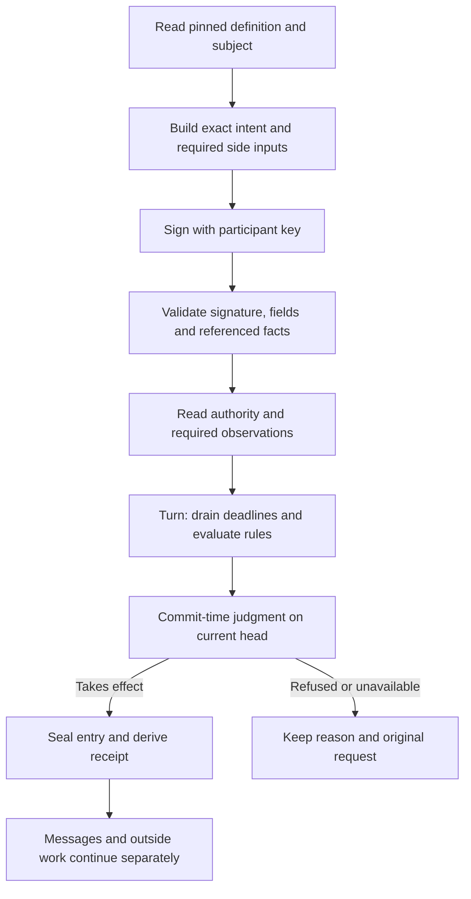

# The life of an act

For a client or application builder, this page follows a request from the
meaning the application declares to the receipt the participant keeps.

An **act** is something a scope's definition declares that a participant
can sign. The participant signs an **intent** for that act. The scope
decides whether the request takes effect.

## Choose the exact meaning and subject

A scope pins its definition at its creation. That definition declares each
act's target item type, fields, required action, guards, effects and
messages. Read the definition the scope pins. An act's name alone does not
tell you its meaning.

The intent binds the target scope and its incarnation, the signing key,
the act kind, the item, the item revisions the signer expects, the field
values, an idempotency key and a deadline. A verdict names the version it
reviews. If that version changes, the participant makes a new decision. A
client never retargets a signed request.

Fields may name exact foreign facts. Detached text travels beside its
digest. Platform fields may require values that are supplied separately,
within their declared byte domains. Supply those bytes as the definition
declares them. Hashing a label or substituting the latest head does not
produce the required evidence.

A key need not be enrolled for every act. Join checks the invitation and
the new signing key. Creating a repository uses the register's creation
policy. Those two rules allow no ordinary member act.

## Read before committing, judge in the transaction

The service checks the signed input and reads each foreign fact against
its reference. It obtains the authority observation the request needs.
Rules that need evaluation run on a snapshot before the storage commit.

A turn first applies each due deadline, in a bounded order. It then checks
that the head has not moved, judges the input on the transaction's clock
reading, and either commits the derived entry or answers without the act
taking effect. If another input moved the head during preparation, the
turn starts the judgment again, within its restart budget. A missing
authority read makes the answer unavailable. It never becomes permission
inferred from the client's view.

Only the new entry, its retained inputs, its sends and the folded state
share that local transaction. Other scopes do not join it. Their messages
and the replies of outside operations become later inputs with their own
judgments.

## Distinguish the five answers

| Answer | Meaning and next step |
|---|---|
| `accepted` | The act took effect: the scope recorded it. Keep its receipt and the exact intent. Follow any remaining messages or publication work. |
| `refused` | The request failed a check at the stated head. Read its reason and any named guard. Inspect before you change the request. |
| `unavailable` | The reply does not say whether the act took effect. Keep the original intent and inspect. Due entries, or an earlier entry for this act, can exist despite the reply. |
| `mismatch` | The key's idempotency key already belongs to a different intent that took effect. Inspect that record. Do not send new bytes under the same key. |
| `archived` | The act took effect at a position now below the scope's journal floor. A repeated intent for that act gets this answer, and so does a read of such an entry. It names the floor, the archive commit that covers the entry, and the entry. Read the entry from the archive. Do not sign the act again. |

A transport failure gives no answer at all. A lost reply does not mean
that the scope did nothing. To ask for settlement or an exact replay, the
caller needs the same original signed intent. When that key and
idempotency key already have an entry, the exact replay returns the
earlier receipt, and no second act takes effect. Timed work can still
prevent that receipt from being returned on a given turn. A read that says
"not found" is not permission to sign a new act.

Keep the signed intent yourself. The native API can settle a lost reply
only from the original intent. The command line keeps a saved-request
journal for `join`. Its `act`, `edit` and `merge` commands do not keep
one. Browser memory does not survive a reload or the loss of a device.

## Follow effects to their own outcomes

Attention names members and reasons. It gives no permission. Messages
have outbox IDs and receiver decisions. Outside operations keep their
attempts and their confirmed, refused or unknown outcomes. An attempt
whose reply was lost stays pending work. The driver does not send the
original mutation again because its reply was lost.

For a merge, the act opens the workflow when it takes effect. Later
destination and change entries establish publication and Merged. Read
those entries when you need the result, not only the first receipt.

A definition is immutable for the life of its scope. Every entry is
judged with its pinned meaning.

## Source

Checked against main `5dc9765f` on 30 October 2026. Sources:
[intent](../../packages/contract/src/intent.ts),
[submission and settlement](../../packages/scope/src/core.ts),
[the turn](../../packages/scope/src/turn.ts),
[declared field shaping](../../packages/client/src/declared.ts),
[the answers](../../packages/contract/src/result.ts), and
[outside operations](../../packages/scope/src/operations.ts).
