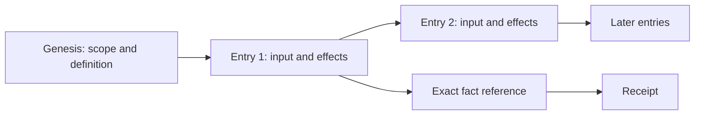

# The record

A receipt proves that one scope recorded one act. This page says what
that covers, where the evidence behind it is, and what a consistency
report leaves open.

Every scope has its own numbered journal. The first entry records its
creation. Each later entry names the hash of the previous entry. An entry
records one input, the facts used to judge it, the prepared rule results,
the item changes it derived and the messages it sends. **Folding** means
applying the recorded entries in order to derive the scope's current
state. Views and summaries help you read that state. The entries explain
how it was reached.

An exact **fact reference** names a scope's ID, kind and incarnation, an
entry position and that entry's hash. A position such as "entry 12" has a
meaning only inside its own scope. An incarnation tells this lifetime of
the scope from an earlier lifetime under the same scope ID.

## Keep the receipt

An act that takes effect returns a receipt. The receipt holds the entry's
fact reference, the pinned definition, the intent digest, the effects and
the outbox ID of each message the entry sent. The scope builds the receipt
after it seals the entry, so the receipt is not part of the entry's own
bytes.

A receipt locates the request that took effect and its immediate changes.
It does not say that a message took effect in another scope, that a Git
host published a commit, or that a provider revoked a token. Those
outcomes need their own entries and evidence. Keep the original signed
intent too. You need it to settle a lost reply.

The word "commit" can mean three things here:

| Evidence | What happened |
|---|---|
| Local storage commit | One scope kept an entry and its derived state in one transaction |
| Git commit object | Git bytes identify a tree, parents and commit metadata |
| Recorded publication | The destination recorded its publication outcome, with the evidence its rules require |

A merge that has taken effect is the first of these, not the third. The
change definition sets a change to Merged after it receives the
destination's published outcome. The destination also writes its own
publication receipt to the repository. That receipt is a different thing
from the receipt that submitting an act returns.

## Read with provenance

When you judge work, follow the exact references, not a current title or
the latest branch. An entry can name foreign facts and retained text by
digest. Those links let you check which version, authority observation or
rule value the judgment used. They do not make later changes apply to
earlier judgments.

The HTTP service provides authenticated journal pages, entries, stored log
bytes and retained-input reads. The command line provides the `log` and
`verify` commands. [Join a room and publish one text
change](../../apps/room/docs/first-change.md) shows them in use, and
[Scopes](../scopes.md) describes the read interfaces.

A detached text can be removed under a recorded tombstone. The journal
still identifies that redaction, and a verifier cannot recreate the
removed words. Missing bytes without a recorded basis are not a complete
proof.

## What verify tells you

An integrity check compares byte identity, chains and signatures. Replay
also derives each judgment again from the recorded inputs, the retained
dependencies, the definition code and the recorded times. Its report names
the target head, the coverage, the trusted anchors, the missing
dependencies and the other trusts.

"Consistent" means that the checks of that mode hold for the stated
coverage and those trusts. It does not prove that the journal ends where
the service says, unless a head you kept independently establishes the
target. It does not prove a provider's action in the world because the
recorded answer replays. A source whose ancestry cannot be derived stays
incomplete even when its other entries match.

Use a receipt you kept to identify the head when you compare records. Read
a report of a missing dependency, an incomplete source or an unsupported
definition as a limit on the conclusion, not as success. Room discovery in
`verify --all` follows the recorded creation journals of that room, not
every scope on the service. Check publication and outstanding pending work
separately.

## Source

Checked against main `5dc9765f` on 30 October 2026. Sources:
[entries and receipts](../../packages/contract/src/entry.ts),
[the report shape](../../packages/contract/src/report.ts),
[the CLI verifier](../../packages/cli/src/commands.ts),
[replay limits](../../packages/replay/README.md), and
[the change publication handler](../../apps/room/lanes/src/change.ts).
