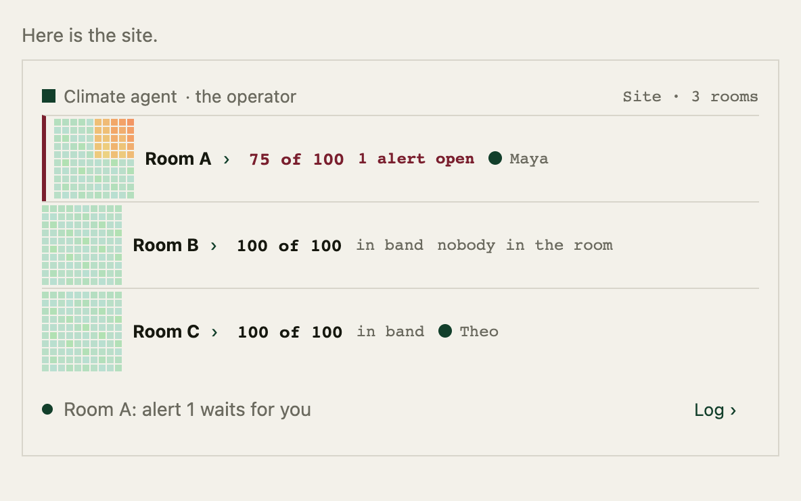
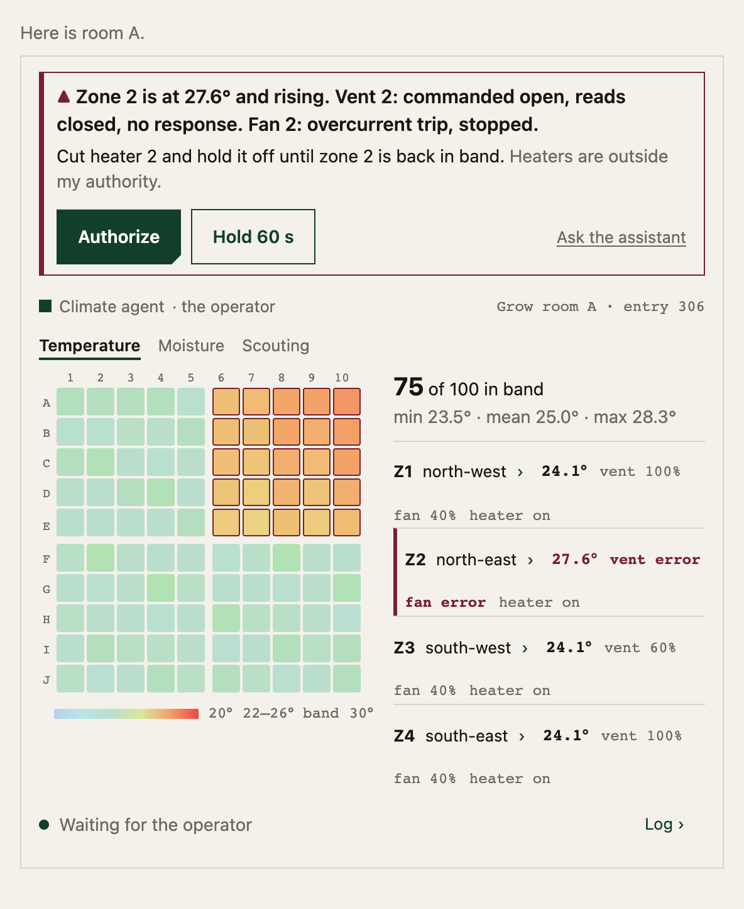
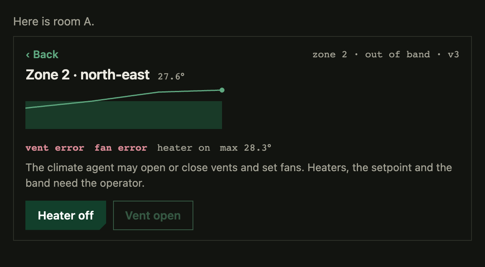
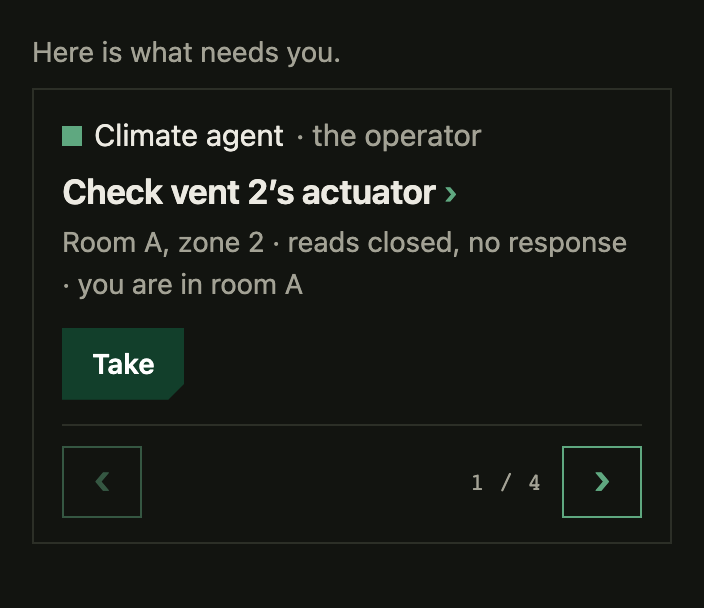
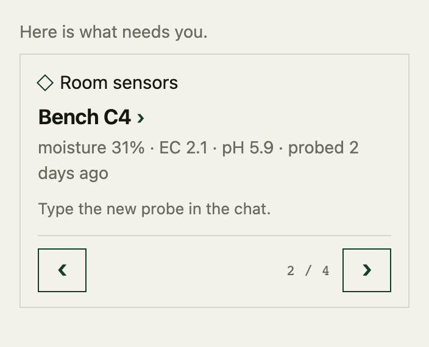
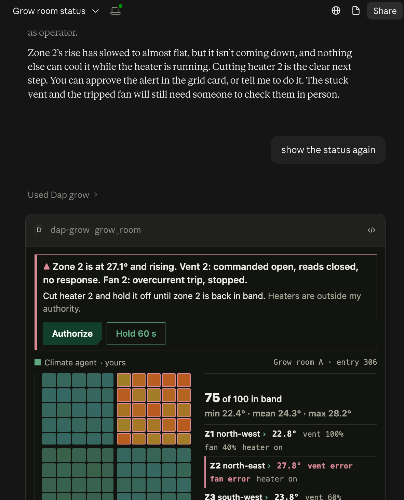

# A grow operation as a dap application: the interaction and the build

17 October 2026. Design note. It is approved (`ea18571e`) and landed at
`90c8c483`. It describes a second application
on the same fabric as the journey: a growing operation whose people,
agents and sensors share one room. It says what each member sees and does,
and how the application is built once the
[self-contained applications](2026-10-15-self-contained-applications.md)
direction and a generic view description exist. It commissions nothing.
Plan 033, of 18 October 2026, builds this application first, as the demo,
after the archive milestone and before the journey's slices (section 7).

The direction was chosen on 17 October after two throwaway prototypes in a
desktop AI app (section 5). The application is fictional. No grower, device
or site is real.

## 1. Why this application

The journey shows software work: a request, a question, a review, a
landing. Everything that needs a person needs them because a review or a
decision is theirs. This application tests three things the journey
cannot:

- **Whether the card kit is generic.** The
  [compact cards design](2026-10-17-compact-cards-design.md) says the kit's
  card takes an item kind, the displayed revision, an actor chip, the
  reasons this item needs this person, at most two acts bound to that
  revision, a one-line model context and a text fallback, and knows
  nothing about lanes. A live temperature grid with an alert is as far
  from a change review as an item gets. If the same card carries it, the
  kit is generic.
- **Authority as the reason something needs you.** A climate agent may
  move vents and fans. It may not touch a heater. The card shows the
  agent's own acts as entries and asks the operator only for what the
  agent may not do. This is the rule question "is this act allowed in this
  context", made visible.
- **A live surface that is also the record.** Readings arrive on their
  own clock. A fault appears, the agent acts, an alert fires, a person
  intervenes, the room recovers, and the incident closes with its entry
  range. The surface the person watches and the journal that outlives the
  service are the same thing.

A fourth point is the one the prototypes made obvious: the card is the
primary place to act, and the chat beside it works just as well. The model
reads a one-line context at every change and calls the application's tools
when asked. Neither replaces the other.

## 2. The operation

A site with three grow rooms. Each room is a 10 × 10 grid of cells, rows A
to J, columns 1 to 10, in four zones. Each zone has a vent, a fan and a
heater. The setpoint is 24° with a band of ±2°. Benches carry plants;
tenders probe them by hand for moisture, conductivity and acidity, measure
height, and count what the sticky traps caught.

The members of the room:

| Member | Kind | Controller | What they may do |
|---|---|---|---|
| Operator | person | | Heaters, setpoint and band; authorize what an agent may not do |
| Head grower | person | | Watering outside the schedule; chemical applications, with a record |
| Day tender, night tender | people | | Probe benches, take tasks, report with evidence, arrive and leave |
| Climate agent | agent | the operator | Vents and fans, inside each zone's limits; raise alerts |
| Irrigation agent | agent | the head grower | Water inside the schedule and amounts; ask for more |
| Room sensors | agent | the operator | Report readings and device states; nothing else |

Every agent names its controller, as the journey's design requires. The
model in a member's own AI app is not a member. When it acts on the
member's behalf, the act is the member's, signed by the host with that
member's key, and the card shows it as theirs.

## 3. Authority

Authority is declared twice, as the
[application guide](../docs/write-an-application.md) describes: an act's
`grant` names the action its signer must hold, and membership says which
role holds which action; the act's guards then decide whether this act,
on this item, in this state, may take effect. Being allowed an action does
not replace the guards.

| Action | Roles | Acts it covers |
|---|---|---|
| `grow.sense` | sensors | `observe`: a reading summary; `report-device`: a device's reported state |
| `grow.climate` | climate agent, operator | `set-vent`, `set-fan`; `raise-alert`; `close-incident` |
| `grow.heat` | operator | `set-heater`; `set-band`; `authorize` an alert's proposal, which is itself the heater command |
| `grow.water` | irrigation agent, head grower | `water` inside the schedule |
| `grow.water-more` | head grower | `approve-watering` outside the schedule |
| `grow.apply` | head grower | `apply`: a chemical application, with product, rate and reason |
| `grow.tend` | tenders | `probe`, `take-task`, `report-task`, `arrive`, `leave` |

Each device kind has its own act, because an act's `grant` is one fixed
string (`ActType.grant` in
[definition.ts](../packages/contract/src/definition.ts)), not a choice a
guard makes. `set-vent` and `set-fan` need `grow.climate`; `set-heater`
needs `grow.heat`. The climate agent holds no `grow.heat`, so nothing has
to tell devices apart at judging time: the grant does. A kind guard on
each act still refuses a vent act aimed at a heater item.

The operator's `authorize` is itself the heater command. Its effects move
the alert to `authorized` and name the heater item too, setting its
commanded state to `off`, and the operator who signs it holds
`grow.heat`. The climate agent proposes and never signs a heater act; an
authorization entry grants it nothing. "Restore heater 2?" later in the
story is the same shape: the agent proposes, the operator's `authorize`
commands.

A device item holds three facts, and no act writes more than one of
them. Its **target** is the commanded state, written by `set-vent`,
`set-fan`, `set-heater` and `authorize`. Its **reported** state is what
the sensors last observed, written by `report-device`; it is `error`,
with the sensors' description, while the device is failing. Its
**outcome** is the device-command owner's answer to the last command,
`confirmed`, `refused` or `unknown`, recorded by that capability's
operation record rather than by a member's act. A command never writes
the reported state, an observation never writes the target, and a
reported `error` keeps the last target. So a late observation of heater 2
on, after the operator has commanded it off, is recorded beside the
target and is not a command. The error guard reads the reported state.

Commanding a device is an outside effect. The package declares a bounded
device-command capability whose owner sends each target at most once and
records the outcome, as the platform's
[operation driver](../packages/scope/src/operations.ts) does for its own
sends. That owner is not designed here; it is a prerequisite (section 7,
open question 6). The sensors' next `report-device` is the evidence of
what the device did. A written target never stands for a physical change,
and an unknown outcome stays unknown, as the application guide's
outside-effect rule says.

Three guards carry the rest of the story:

- A device whose reported state is `error` refuses `set-vent`, `set-fan`
  and `set-heater`, and the refusal quotes the description the sensors
  wrote. `error` is the one reported state for every failure; the
  description says which. The definition does not enumerate failure
  modes.
- `raise-alert` needs the zone out of band and the agent's own devices at
  their limits. An agent cannot ask a person to do its work for it.
- `authorize` and `hold` name the alert's revision. An authorization of
  version 1 after the hold has produced version 2 is refused as stale, in
  one line, and never applied to the new version.

A timed rule returns a held alert to open after 60 seconds, as a new
revision. Another marks a bench stale when no probe has been recorded for
48 hours.

## 4. The interaction

Each member opens the application in their own AI app, on a laptop or a
phone. The chat carries the narration. The cards carry facts and buttons.

### Morning

The operator asks for the site. An overview card shows the three rooms as
a strip: each room's name, how many of its cells are in band, who is in
it, and whether anything is open. Clicking a room opens its grid card.

The grid card is a heatmap of the hundred cells, a legend with the band,
the count in band with min, mean and max, and one row per zone with its
mean and its three devices. A line under the grid shows what the climate
agent is doing, or that all zones are in band. The card refreshes itself.
The cells are a picture, not targets: ten targets of the kit's 44 px size
do not fit across a chat card, so a zone's row is the way in. Clicking a
zone row opens the zone: a sparkline of its recent
readings against the band, its devices, the two authority rules that
apply, and two acts, which for the operator are heater on or off and vent
open or closed. Back returns to the grid.

The day tender arrives, which is an act. On her phone, "what needs me" is
a carousel, one bench at a time: the benches whose last probe is oldest,
with the last reading and its age. She types "bench C4, moisture 31,
EC 2.1, pH 5.9" into the chat; the model makes the `probe` act for her;
the card advances to the next bench. The grid gains layers: temperature,
moisture, scouting. Each layer shades cells by value and by the age of
the reading, so a bench nobody has probed for two days is visible from
across the site.

### The fault

Vent 2 in room A reads closed with no response to its command. The sensors
record the device as in error, with that description. Zone 2 starts to warm. The climate agent raises fan 2 to full;
the fan trips; the agent opens vents 1 and 4 to full for a cross-draft.
Each of these is an entry, marked as within its authority. The grid shows
zone 2 turning amber, then red, with its row highlighted and its devices
in red.

When zone 2 is out of band and the agent's own devices are at their
limits, the agent raises an alert. Two different cards reach two different
people:

- **The operator** sees the alert at the top of the grid card: "Zone 2 is
  at 27.4° and rising: vent 2 reads closed and does not respond, and fan 2
  has stopped on an overcurrent trip. Cut heater 2 and hold it off until
  zone 2 is back in band. Heaters are outside my authority." The two
  device facts are the sensors' own descriptions, quoted. Two acts, Authorize and Hold 60 s, and a link
  that hands the question to the model in the chat. The model's context
  says what is open and who it waits on.
- **The day tender**, who is in room A, sees a task in her carousel:
  "Check vent 2's actuator in room A, zone 2." She takes it with one tap,
  walks over, frees the jammed vane, and reports it. The report carries a
  photo, kept in the room's custody. The sensors then record vent 2 open.

The operator authorizes, which writes heater 2's target `off`, signed by
the operator: one entry. The device-command owner records the command's
outcome, and the sensors report heater 2 off, which now matches its
target: two more entries. The zone cools. The agent returns vents 1
and 4 to normal, and, because vent 2 is free again, asks once more: "Vent
2 is responding. Restore heater 2?" That too needs the operator, so it is
one more card with two acts. When every cell of zone 2 is in band the
agent closes the incident. The grid card shows "Incident 1 closed · entries
302–318" and fan 2 flagged for maintenance.

### A second thread at the same time

While the incident is open, the irrigation agent finds conductivity high
on row D and wants to water it before its scheduled time. That is outside
its schedule, so it asks the head grower. The head grower's carousel shows
one item: the request, the readings it rests on, and Approve or Decline.
Two things needing two people at once is what the per-member carousel is
for. Neither person sees the other's item unless they ask.

### The record

Anyone can ask "what happened in room A today?" The model answers from the
journal, through the application's read tool, and names the entries. At
the end of the day the room's journals are archived under the
[journal archive design](2026-10-09-shared-language-volatile-acts.md#15-journal-archive-in-git-amendment-12-october-2026),
so the record outlives the service.

### What the cards do not do

They do not restate themselves in the chat. An ordinary act updates the
card in place and records a receipt in the model's context; the chat
receives a message only when the person hands off to the model. They do
not act on a stale revision. They do not let an agent's screen sign a
person's act, or a person's screen sign a room act: the host signs only
the installation's own declared acts, as section 5.1 of the applications
note requires.

### Mockups

Static mockups of the cards above are in
[the mockup directory](2026-10-17-grow-operation-application-design/):
twelve pages, six states in light and dark, generated by its `build.py`
from fixed fictional data, with renders in `renders/`. They show layout
and content, not behaviour: the pages do not poll, act or resize. Each
page fits a phone: the chat column is the viewport less 16 px gutters,
up to the page's width, the header and the control rows wrap, and no
control is clipped. Measured in a headless browser at 592 and 320 px,
all twelve pages have no sideways scroll, every active control is at
least 44 px in both dimensions and inside the viewport, and no two
controls overlap.

The operator's overview of the site, with a room's cells in miniature,
its count in band, what is open, and who is in it:



Room A while the alert is open. The alert block carries the sensors'
descriptions, the agent's proposal and the two acts. The layer switch,
the row and column labels, the legend and the zone rows are below it:



Zone 2 opened from its row, in the dark theme: the sparkline against
the band, the device states, the two rules, and the two acts, with the
vent act disabled while the vent is in error:



The day tender's phone: the task routed to her because she is in the
room, with its one act, and a stale bench whose new probe is typed into
the chat rather than into the card:





## 5. What the prototypes showed

Two throwaway prototypes ran inside a desktop AI app under the MCP Apps
extension, with fictional data and no room. They are behaviour references,
outside the repository; no code from them is proposed for it.

The first was one card that advanced in place through a software task:
asked, working, question, review, landed. The second was the grow room of
section 2 with one zone, a fault on a timer, the agent's own acts, an alert
with Authorize and Hold, a zone screen with a sparkline and two acts, a
vent in error that refused a command, recovery, and a closed incident with
its entry range.

A capture of the second prototype inside the desktop AI app, in its dark
theme. Above the card, the model's reply narrates the situation and
defers to the card: it says the heater cut is the next step, that the
person can approve the alert in the card or ask the model to do it, and
that the vent and the fan still need someone in person. Below it, the
card carries the alert, the live grid and the zone rows. The handoff
link's label is masked because it names the host:



What held in both:

- The card was the primary place to act, and the chat worked equally well.
  The model called the application's tools when asked and otherwise stayed
  quiet, because the tool text described the card instead of its data and
  the context line told it what was on screen.
- A view that polls through the host kept a live surface current without
  a chat turn. The frame grew and shrank with its content.
- An old card refused an out-of-date act in one line.
- Authority as the reason for an alert read naturally: the agent's acts
  were entries, and the card asked only for what it may not do.

What they did not show: more than one person; a phone; a real device; a
host that pushes changes to a view instead of being polled; and media in
custody.

## 6. How it is built

### 6.1 The package

One package, under the applications note's section 4: a manifest, one or
more definitions, read projections, presentation, act descriptions,
scenarios and an upgrade path.

**Scopes.** One `site` scope for the site, and one `room` scope per grow
room. The site scope holds the rooms and who is present where. A room
scope holds its zones, devices, benches, readings, alerts, incidents,
tasks and watering requests. Two scopes share no storage, so a room's
incident never waits on another room.

**Items.** `zone` (band, setpoint, state in or out of band; refs to its
devices), `device` (kind; three facts as section 3 defines them: the
target `open`, `closed`, `on` or `off` with its level; the reported
state, the same values or `error` with the sensors' description, such as
"commanded open, reads closed, no response"; and the outcome of the last
command), `bench` (last probe values and the entry that recorded
them), `alert` (states `open`, `held`, `authorized`, `closed`; parties: the
agent that raised it and the member who authorized; values: text,
proposal, revision), `incident` (refs to its alert and its first and last
entries), `task` (states `offered`, `taken`, `done`; party: the performer;
ref: the report's evidence) and `watering` (states `asked`, `approved`,
`declined`, `done`). Each change to an item raises its revision, and an
act names the revisions it expects.

**Acts.** Section 3 lists them with their actions. `observe` is a
comment-form act. A comment changes no item and carries no guards,
effects or sends; the validator refuses one that does
([handlers.ts](../packages/derive/src/validate/handlers.ts), the rule
named "section 6.4"; [the ten terms](../docs/manual/ten-terms.md),
"Step"). So `observe` records a reading summary in its input and nothing
more, and the `grid` projection derives the latest readings from those
entries. `report-device` is a guarded transition on the device item,
signed by the sensors, that writes the reported state only and, for
`error`, the description. `set-vent`, `set-fan` and `set-heater` are
transitions on the device item that write the target only. The outcome is
written by the device-command capability's operation record, not by an
act. `raise-alert` opens an alert; `authorize`, `hold` and
`close-incident` transition it, and `authorize` names the heater item as
well, writing its target. `probe` transitions a bench; `take-task`
and `report-task` transition a task. `arrive` and `leave` are comment-form
acts on the site scope, and the presence projection derives who is where
from them.

**Timed rules and handlers.** The hold expiry and the stale-bench rule are
timed rules. A handler lets the site scope receive each room's open-alert
count, so the overview reads one projection.

**Capabilities.** The package requests three. First, a bounded outside
read of the sensor gateway's latest samples, so the live grid shows the
current second without an entry per second; the journal keeps what
decisions depend on, not every sample (section 6.4). Second, custody of
files sent with a report, for the tender's photo. Third, device commands:
a bounded owner that sends each commanded state at most once and records
its outcome (section 3). Notifications come later, with the journey's
attention work. Each capability is bounded by what the manifest declares
and the admin grants at install. Bounded capabilities themselves are M2
work (section 7).

**Scenarios.** The fault story of section 4 is the package's first
scenario: readings, the agent's acts, the alert, a hold, an authorization,
recovery and closure, with the refusals of a stale authorization and of a
command to a device in error. `dap check` runs and replays it. The simulated
room from the prototype becomes that scenario's source of readings.

### 6.2 The views, described generically

The applications note puts presentation in the package as `ui://`
resources bound to the projections. This application adds the view
description that makes most of those resources unnecessary. The kit ships
the generic kinds; a package declares its views as data; the room's MCP
endpoint derives the tools; the kit renders each view inside any host.

A view declaration says, for one view:

- **its projection**: which read projection it shows, and for which item;
- **its kind**: `card` for one item, `carousel` for the items that need
  the viewer, `record` for a full item with Back, `log` for entries, or
  `surface` for a package-supplied resource such as the heatmap;
- **its fields**: which projection fields are the title, the summary, the
  actor chip and the facts;
- **its revision**: the field every act binds to;
- **its acts**: at most two, each with its act, its label, a rule
  expression saying when it is offered, and the action the viewer must
  hold for it to be offered at all;
- **its context**: a template for the one line the model keeps;
- **its fallback**: a template for the text a host without views shows;
- **its refresh**: how often the view asks the host for the projection
  again, until hosts can push;
- **its display**: inline or full screen, and what Back returns to.

Two of this application's views, as a sketch of the form:

```json
{
  "alert": {
    "kind": "card", "projection": "room.alert", "item": "alert",
    "title": "text", "summary": "proposal", "actor": "raisedBy",
    "revision": "revision",
    "acts": [
      { "act": "authorize", "label": "Authorize", "needs": "grow.heat", "when": "state = 'open'" },
      { "act": "hold", "label": "Hold 60 s", "needs": "grow.heat", "when": "state = 'open'" }
    ],
    "context": "Alert {id} v{revision} {state}: {text} {waiting}",
    "fallback": "Alert {id} v{revision} ({state}): {text} {waiting}",
    "waiting": {
      "open": "The agent asks the operator to {proposal}",
      "held": "Held by the operator; it reopens in {remaining} s.",
      "authorized": "Authorized; the agent is watching zone {zone}.",
      "closed": "Closed."
    },
    "refresh": "2s", "display": "inline"
  },
  "grid": {
    "kind": "surface", "projection": "room.grid", "resource": "ui://grow/grid",
    "opens": { "zone": "zone", "alert": "alert" },
    "context": "{room}: {inBand} of 100 cells in band; {status}",
    "fallback": "{room}: {inBand} of 100 cells in band, min {min}, mean {mean}, max {max}. {status}",
    "refresh": "2s", "display": "inline"
  }
}
```

The context and fallback derive from the displayed revision's state, so
a held alert never reads as open, and the acts are offered only in the
state their `when` names.

The `alert` card needs no package code: the kit renders it from the
declaration and the projection. The `grid` surface is static presentation
in the package, a heatmap that reads its projection through the host and
opens the declared zone and alert views. What it may do is what the host
enforces, not what the absence of keys implies. Under section 5.1 of the
applications note a package frame may read only its installation's
projections and may ask the host to sign only its installation's declared
acts, never a room act or another installation's act, and the host owns
and enforces those boundaries. This surface declares no acts, so the host
refuses any signing request from it. That read-only permission is a rule
of the view description for the host to enforce, not a property of the
sandbox, and it does not exist yet. M1's trusted-package limit holds until
the boundary does.

From the declarations the room's MCP endpoint derives, for each view, a
tool the model may call, which returns the fallback text and the card's
identity, and a view-only tool, which returns the projection to the view.
The model never receives the card's data in its tool text; it receives
the context line through the host. This is the contract the journey's
cards design already states, applied to a second application.

The view description is part of the presentation id, not the semantic id,
so a room adopts a changed view with one `present` act and no new install.

### 6.3 The hosts

The same resources serve every host. A desktop AI app and a phone's chat
app render them under the MCP Apps extension, with the per-application
sandbox origin and the content security policy that the package's
resource metadata declares. The dap web host, when it exists, renders the
same resources in its own page. The kit's phone layout stacks the grid
above the zone rows from 320 px wide, with the targets the cards design
requires.

The model in each member's app sees that member's context and tools. The
host signs that member's acts with that member's key, so the irrigation
agent's request cannot be approved from a tender's app, however the model
is asked. Agents are members with agent keys and named controllers; the
climate agent runs wherever its controller runs it and signs with its
own key.

### 6.4 The record

The journal records what decisions depend on. Sensors write one reading
summary per room every five minutes, and a threshold entry when a zone
leaves or enters the band: a few hundred entries a day. The live grid
reads the gateway's latest samples through the bounded outside read, and
the zone sparkline reads the recorded summaries. The whole-scope capacity
bounds of request `113a54bd` landed at `62423347`, with provisional values,
and apply to each room scope. They admit new work against what the
scope retains and the reservations of work already admitted; they reserve
nothing for future acts. A finite daily rate still fills a finite budget
in time, and new acts can then be refused. How much a room retains, how
readings are sampled and when old summaries are released is a policy the
package must declare and the room's admin must set. That is future work,
not a guarantee this note can make from traffic estimates. Work already
funded, such as a confirmation whose bytes are reserved, is admitted ahead
of an unadmitted new act.

Every act by a person or an agent is an entry. An incident's record is
its entry range. The day's journals are archived in Git and replay without
the runtime, which is the archive milestone's point. A reading summary
that fails to arrive is recorded as missing, not filled in.

## 7. Order and slices

This application was written to follow the journey. Plan 033, of 18
October 2026, builds it first, as the demo, after the archive milestone,
with M1 ahead of it. It needs the card kit, which landed on 18 October,
and from the applications note both M1, which makes a
trusted package installable, and M2, which adds declared projections, the
generic interface, several scopes in one package, bounded capabilities
and presentation-only updates (applications note, section 7, "M2. A
complete application from any publisher", at main `df806354`). Section 6
uses all five, including `present`. Two prerequisites belong to no
milestone and need their own design: the device-command owner of section
3, and custody for a report's evidence (open question 4). None of this is
pulled into S2 or M1 by this note. Plan 033 reorders
[plan 032](plans/032-2026-10-17-journey-as-acceptance-target.md) so that
this application comes before the journey's slices. Each slice says what
it needs:

- **G0. Definition and scenario.** The `site` and `room` definitions of
  section 6.1 with their actions, guards and timed rules; the fault story
  as a scenario with a simulated source of readings; `dap check` passes
  and replays it. Needs today's runtime and M1's `dap check`; the
  simulated source stands in for the sensor read and the device owner.
  Done when the scenario's refusals and closures match section 4.
- **G1. Views on the kit.** Needs S2 and M1. The derived tools and the
  declared projections are M2; before M2, G1 runs on a hand-written
  projection as a trusted package, and is a sketch of the generic form,
  not its witness. The alert, zone, carousel and log views as
  declarations; the grid as a surface resource; the derived tools. Done
  when the operator's path of section 4 runs inside a test host with the
  kit's existing checks: app-only data, quiet context, receipts, stale
  refusals, resize.
- **G2. Measurements from the chat.** The tenders' probe act through the
  model, the bench carousel and the three grid layers. Needs M2's declared
  projections for the layers. Done when a probe typed in a chat appears
  in the layer and advances the carousel.
- **G3. Routing.** Alerts to the holders of the authority they need, tasks
  to the tenders present in the room, requests to the head grower. Needs
  several scopes in one package (M2) for the site scope, and the journey's
  attention work for anything beyond the carousel. Done when the fault
  produces the two cards of section 4 for two members and the watering
  request a third.
- **G4. Record and archive.** The incident's entry range, "what happened
  today" from the read tool, and the day's archive. Needs the archive
  milestone's clone and verify (plan 032, section 2a) and custody for the
  photo. Done when the archived journal replays and the model's answer
  names entries that exist.

Exit test: three people on their own devices, each in their own AI app,
in one room, through the fault story, with the agents running under their
controllers. The same shape as the journey's exit test, with different
people.

Status, 21 October 2026: G0 (`9c32a384`), G1 (`b54f8880`), G2
(`4b4d58b0`) and G3 (`426504d8`, `f6d402b0`) have landed. Plan 033's G5a
(`a00eda3b`) and G5 (`7594822c`) have landed, and G5 runs on the hosted
`dap-grow` Worker. G4 is not built.

## 8. Open questions

1. **Pushing changes to a view.** Polling through the host every two
   seconds worked in the prototype. Whether hosts will let a server
   notify a view, and at what rate, decides the `refresh` field's future.
2. **Readings as entries or as outside reads.** Section 6.4 keeps samples
   outside the journal and summaries inside. The line between the two is
   a policy the package declares; the right default needs the capacity
   bounds to land first.
3. **Presence.** `arrive` and `leave` as acts are enough for routing. A
   device's own location is not used, and should not be without a
   separate decision.
4. **Evidence for a report.** A photo in custody is the first kind. What a
   report may claim from it, and who may read it, is the custody design's
   question, not this note's.
5. **The agent's limits as data.** Section 3 puts the climate agent's
   limits in guards. Whether a room's admin can change them without a new
   definition is the rules question the evidence-rules design opened for
   landings, applied to devices.
6. **The device-command owner.** Who sends a commanded state to a vent, a
   fan or a heater, how its outcome is recorded, and what the room may
   conclude before the sensors confirm it. Until that owner is designed,
   the scenario's commands are simulated and the device item records
   intent, not effect.

## Source

Written by the planner against main `df806354` from the
[self-contained applications note](2026-10-15-self-contained-applications.md)
(sections 3, 4, 5.1, 7 and 8), the
[compact cards design](2026-10-17-compact-cards-design.md), the
[journey views design](2026-10-17-journey-views-design.md),
[plan 032](plans/032-2026-10-17-journey-as-acceptance-target.md),
[the ten terms](../docs/manual/ten-terms.md), the
[application guide](../docs/write-an-application.md), the act form in
[definition.ts](../packages/contract/src/definition.ts), the comment rule
in [handlers.ts](../packages/derive/src/validate/handlers.ts), the
[operation driver](../packages/scope/src/operations.ts), the
[use-case catalogue](../docs/use-cases.md)'s sweep entry for feeds and
sensors, and the two prototypes of section 5. The prototypes'
observations were made on one desktop AI app and one stand-in host; they
claim nothing about other hosts. The mockups were generated by the
directory's `build.py` and rendered with a pinned headless browser from a
scratch directory at twice the pixel density; no dependency was added to
the repository. Nothing in this note was run against the dap runtime.
