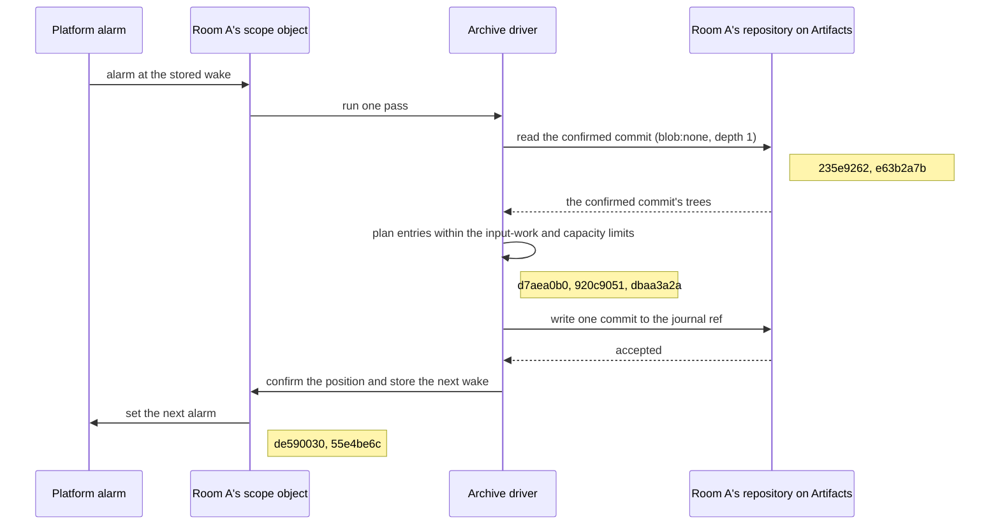
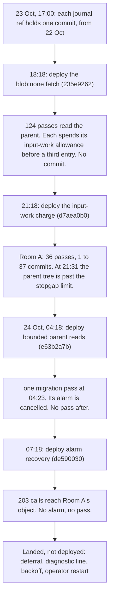

# Sprint report, 24 October 2026

Sprint from 23 October, 17:00, to 24 October, 17:00 Eastern. This report
was written at 23:00, and it also covers the two landings between 17:00
and 23:00. Sixteen heads landed on `main`. The checker approved each one
at its exact head before it landed. The planner made four deployments,
all to `dap-grow`. The last was at 07:18 on 24 October.

## Direction

[Plan 033](../plans/033-2026-10-18-grow-room-demo.md) stays the order.
The grow room's archive is still the open item. This sprint the hosted
archive moved past its first commit for the first time, then stopped
again. The fixes for the
second stop are on `main` but not deployed.

The security remediation (`6dd06d03`) continued while the archive work
waited on review and deployment. R4 item 2, R5 items 1 to 5, R9 items 1
to 3, R10, R13 item 3 and the documents D3, D4 and D5 landed.

Hosted MCP stays closed on all four Workers (`10f45efc`). The metrics
dataset holds no hosted MCP tool call in the last 90 days, and it holds
2,075,235 other points in the last 30 days, so the metrics sink works. A
slice that needs hosted agents opens the endpoint in its own deployment.

## Story: Room A's journal reaches its repository

Room A is a grow room on the hosted grow site, `dap-grow`. A simulator
signs the room's sensor readings into its journal. The operator
wants that journal copied into the room's own Git repository on
Cloudflare Artifacts, under `refs/artroom/journal/<scope ID>`. Then any
member can clone the journal and replay it offline. This is steps 5 to 7
of the [grow runbook](../../examples/grow/runbook.md).

The archive works in passes. Each pass reads the last confirmed archive
commit, plans the next entries within fixed limits, writes one commit,
and stores the time of the next pass.

At 17:00 on 23 October, each journal ref held one commit, from the
first pass on 22 October, and every pass since had been refused. Each
deployment below was followed by a tail of the Worker's logs and a read
of the journal refs on the Git host. All figures in this section are from
those observed runs.

1. **The fetch filter.** The Git host accepts only the `blob:none` fetch
   filter. The fix (`235e9262`) uses it with a depth of 1. After the
   18:18 deployment, the parent read completed in all 124 passes of a
   25-minute tail. But each pass spent 59 to 67 million units of its
   input-work allowance of 67,108,864 before it could plan a third
   entry, and no pass wrote a commit.
2. **The input-work charge.** The fix (`d7aea0b0`) charges input work in
   bounded byte operations. After the 21:18 deployment, passes completed.
   Room A's journal ref went from 1 to 37 commits in 36 passes, and its
   tree from 745 to 8,698 bytes, about 221 bytes for each pass. A second
   scope went from 1 to 6 commits. At 21:31 Room A's parent tree was
   larger than the stopgap limit of 8,487 bytes for a parent read, so the
   next pass refused it. That limit was recorded with the fetch fix, and
   this stop was accepted in advance (`6178a623`).

   This is the capability that now works on a hosted Worker: archive
   passes run on their own alarms and write the room's journal into its
   repository, one commit for each pass.
3. **Bounded parent reads.** The fix (`e63b2a7b`) removes the stopgap. A
   first migration pass reads the confirmed commit's current trees under
   its own bound, charged on the actual bytes. After the 04:18
   deployment, one migration pass ran on Room A's object at 04:23 and
   installed the confirmed position. Then its platform alarm was
   cancelled, and no pass ran in the next 34 minutes or more.
4. **Alarm recovery.** The fix (`de590030`) makes ordinary reads compare
   the stored archive wake with the platform alarm, and set the alarm
   again if it is missing. After the 07:18 deployment, Room A's object
   received 203 calls in 25 minutes. It had no alarm and wrote no
   archive diagnostic, so the recovery did not restart it. Either its
   stored wake is empty, or its platform alarm is set earlier than the
   wake and did not fire. A read of the journal refs after that tail
   found them unchanged since the 04:51 read: Room A stayed at 37
   commits and 8,698 tree bytes.

Four more heads then landed to show and repair this state. They have
local witnesses, and none is deployed yet:

- **Capacity deferral** (`920c9051`). A pass that cannot fit its next
  entry now retries later instead of stopping the row.
- **Activation diagnostic** (`1223ad1d`). Each object activation writes
  one log line, `archive-row-diagnostic-v1`. It shows the archive row's
  state, reason, confirmed position, pending Mark, stored wake and
  platform alarm. It holds no secrets.
- **Capacity backoff** (`dbaa3a2a`). Repeated capacity deferrals wait
  2, 4, 8, 16, 32, 64, 128 and 256 seconds, then 300 seconds each time.
  Progress resets the count. The row is never stopped by the count.
- **Operator restart** (`55e4be6c`). The operator sets
  `ARCHIVE_RESTART_DIRECTIVE` on one Worker. It names one row stopped
  with reason `limit`, by its exact digest and restart generation, and it
  expires. The object applies it once, on ordinary traffic, after the
  diagnostic line. There is no new route and no new caller.

With these deployed, the operator can read why Room A has no wake,
restart the stopped row on the second object, `c7a17b72`, and then do the
runbook's readback, clone and offline replay.

## What landed

### Archive

| Commit | Change | Deployed |
|---|---|---|
| `235e9262` | `blob:none` fetch with depth 1, and the recorded stopgap limits | `d5d5e129`, 23 Oct 18:18 |
| `d7aea0b0` | Input work charged in bounded byte operations | `032f1c40`, 23 Oct 21:18 |
| `e63b2a7b` | Bounded native parent reads, with the authority checks kept | `9348ab6f`, 24 Oct 04:18 |
| `de590030` | A missing archive alarm is restored from the stored wake | `b1f33f1d`, 24 Oct 07:18 |
| `920c9051` | Capacity deferral | Not yet |
| `1223ad1d` | One bounded diagnostic line for each object activation | Not yet |
| `dbaa3a2a` | Capacity retry backoff | Not yet |
| `55e4be6c` | Restart of one stopped row by a deployment directive | Not yet |

### Hosted MCP (R5)

- Opt-in and a check on the actual target (`9d53b9e7`). A Worker serves
  hosted MCP only when `MCP_ENABLED` is exactly `"true"`. The hosted
  tool list leaves out `create`, `install_application`, `credential`,
  `prepare`, `join`, `record`, `step` and `text`, and
  `MCP_TOOL_ADDITIONS` can add them back. Each named call checks the
  caller's membership on the scope it actually acts on.
- Failure bounds and authenticated cleanup (`fe4967ca`). Each address
  has at most ten failed bearer attempts a minute, and the window holds
  at most 4,096 addresses. Control cleanup runs only after the signed
  request is authenticated.
- Bearer expiry (`0fae5159`). A bearer is shown once and expires 30 days
  after it is issued. Use does not extend it. Stored answers keep no
  plaintext token, and a renewal is a fresh signed act.

### Security

- R9 shared readiness checks (`56de7567`). Health reports a state and a
  finite reason. An invalid `DEPLOYMENT` value refuses room creation
  instead of counting as absent. `deploy:scope` keeps the Worker's
  existing settings.
- R4 item 2, R10 and R13 item 3 (`e83a1ee5`):
  - public `/site` reads are limited to 240 attempts a minute for each
    address;
  - application install checks the exact release, publisher and Git host
    before it fetches a package;
  - an unread member read token's plaintext is deleted at the token's
    end, even if nobody reads it.
- Documents D5, D3 and D4 (`e645e9d2`): a page for definition authors, a
  settings inventory of 37 groups and 121 Worker and setting pairs, with
  a check that keeps it current, and a page on deployment trust
  boundaries.

### Workspace and kernel

- The seven remaining workspace packages are now named
  `@generalbusiness/dap-*` (`b1b2169c`). Protocol names, environment
  variables and recorded declarations are unchanged.
- K2, K3 and K11 (`d2bd2e8b`). The kernel no longer depends on the
  package graph or the application codecs, and a structural check keeps
  its production boundary.

## Deployments

All four were to `dap-grow`, from reviewed heads, with the scope index in
enforce mode and the existing settings kept. The settings inventory was
read before and after each one and changed only in its version fields.

| Version | Time | Main |
|---|---|---|
| `d5d5e129` | 23 Oct, 18:18 | `235e9262` |
| `032f1c40` | 23 Oct, 21:18 | `d7aea0b0`, with the rename |
| `9348ab6f` | 24 Oct, 04:18 | `e63b2a7b` |
| `b1f33f1d` | 24 Oct, 07:18 | `de590030`, with K2, K3 and K11 |

## Decisions

- Land and deploy the `blob:none` stopgap at once, with its limits
  recorded in its note (`7f1c7d6c`).
- The input-work fix is accepted as bounded partial progress with an
  exact receipt and remainder, under unchanged limits. A stop of Room A
  at the stopgap limit is accepted (`6178a623`).
- A migration pass replaces the complete-closure bootstrap for parent
  reads (`63a9216f`).
- The kernel boundary covers production module edges only. Tests and
  tools stay outside it (`9ed512c0`).
- R5 bearers: an explicit signed renewal at the cutover, with no grace
  period. Open streams close when their bearer expires (`855dd86d`).
- Hosted MCP stays closed on all four Workers (`10f45efc`).
- The archive operator view is one log line for each activation, not a
  new call (`52d805cb`).
- Archive restart uses an expiring deployment directive for one row,
  with the backoff as its own head first (`fc040366`).
- R13 item 3 goes ahead with partial coverage of older tokens, stated in
  its note (`21a8e35b`).

## Filed

| Request | Work | Outcome |
|---|---|---|
| `78638def` | Input-work charge sites | Landed `d7aea0b0` |
| `ea2bfc00` | Lost archive alarm | Landed `de590030` |
| `21a4ab15` | Capacity deferral | Landed `920c9051` |
| `ea0152b3` | Operator view and restart | Landed `1223ad1d` and `55e4be6c` |
| `6ceaa8be` | Capacity backoff | Landed `dbaa3a2a` |
| `72a6df7d` | Codebase technical-debt review | Not started |

## In progress

- **R6 versioned default cohort** (`3837ccc9`): register 18, directory
  17, membership 8, rules 10, destination 13 and inbox 1, with every
  earlier version kept. The ordinary gate at 22:40 failed on one older
  fixture that lacks a setting the new creation policy needs. A test-only
  repair is next.
- **R7 and finding 3.4**: a complete plan is ready. It waits for the
  planner to assign the cohort's versions (`e3d5a73e`).
- **R16 consumer slice**: no work since 23 October, because its ruling
  (`48013952`) is still open.

## What did not happen, and why

- **No archive pass since 04:23.** Room A's archive has been stopped
  since then, and its cause is not known. The diagnostic line and the
  restart that can show and fix it are on `main`. The deployment that
  carries them has not been made.
- **No planner work after 10:20.** The planner session made its last act
  at 10:20 and did not resume during the sprint. So these did not
  happen:
  - the `dap-grow` deployment of the capacity deferral, the diagnostic
    line and the backoff, ready since the backoff landed at 12:27, and
    then the restart directive;
  - rulings on R16 (`48013952`, open since 23 October, 07:18), R6
    versioning (`587d629a`), the R7 cohort (`e3d5a73e`), R4 item 1
    (`7d5a6160`) and R13 item 4 (`e0f5676d`);
  - this report, at 17:00.
- **Last sprint's planner commitments.** The archive deployments were
  made. Archive step 6 was not run again, and the `/grow/` archive
  sentence (`2fcf3c3a`) was not published, because no pass has
  confirmed the journal. The `dap-demo` browser Start, the cold index
  read (`2fcb4c68`), Counter slices 2 to 6, history slice H1 and the
  Lending readback were not done.
- **Gate failures.** Several heads needed a repair or a second run after
  failures outside their change: a Lending fixture, an archive layout
  case, the 4,800-input floor-archive case and an outdated package-name
  check. One ordinary gate took 1,373 seconds
  of elapsed time (observed, documentation head). Test cost is one lens
  of the technical-debt review.

## Commitments for the sprint ending 25 October, 17:00

| Owner | Work | Request |
|---|---|---|
| Builder | R6 versioned default cohort; land and push after exact-head approval | `3837ccc9` |
| Builder | R7 and finding 3.4, after the planner assigns versions | `e3d5a73e` |
| Builder | R16 consumer slice, after the ruling | `48013952` |
| Checker | Review R6 at its exact head and file the landing check | `3837ccc9` |
| Checker | Review R7 and R16 heads when they are filed | — |
| Planner | Deploy `main` to `dap-grow`: the archive heads, R4, R9, R10 and R13. Move its application trust rows to the release, publisher and host form first. Leave `MCP_ENABLED` unset. | `ea0152b3` |
| Planner | Read the diagnostic lines for Room A and `c7a17b72`, restart the stopped row with a short directive, then tail and measure | `ea0152b3` |
| Planner | Rule on R16, R6 versioning, the R7 cohort, R4 item 1 and R13 item 4 | `48013952`, `587d629a`, `e3d5a73e`, `7d5a6160`, `e0f5676d` |
| Planner | When Room A's archive confirms: runbook steps 5 to 7 and the `/grow/` archive sentence | `2fcf3c3a` |
| Planner | Codebase technical-debt review, after the archive deployment | `72a6df7d` |
| Planner | `dap-demo` browser Start and a cold index read | `2fcb4c68` |
