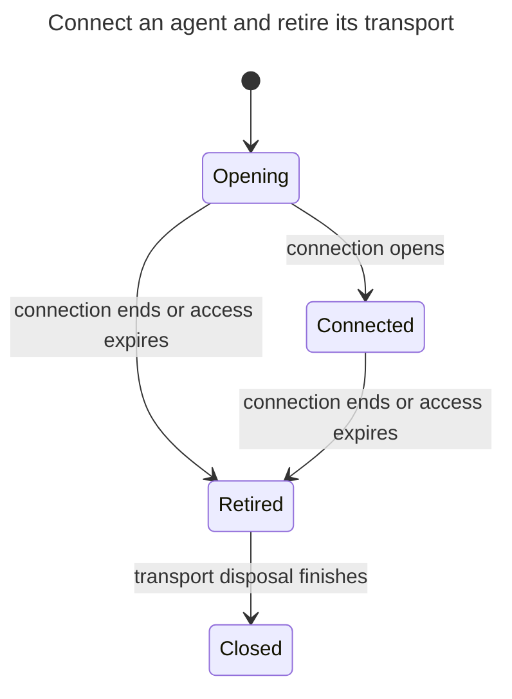
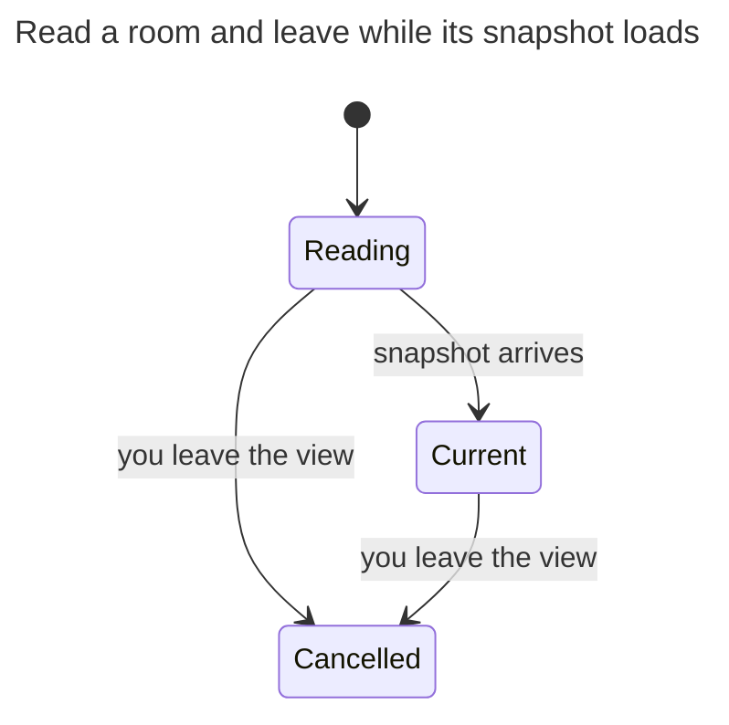
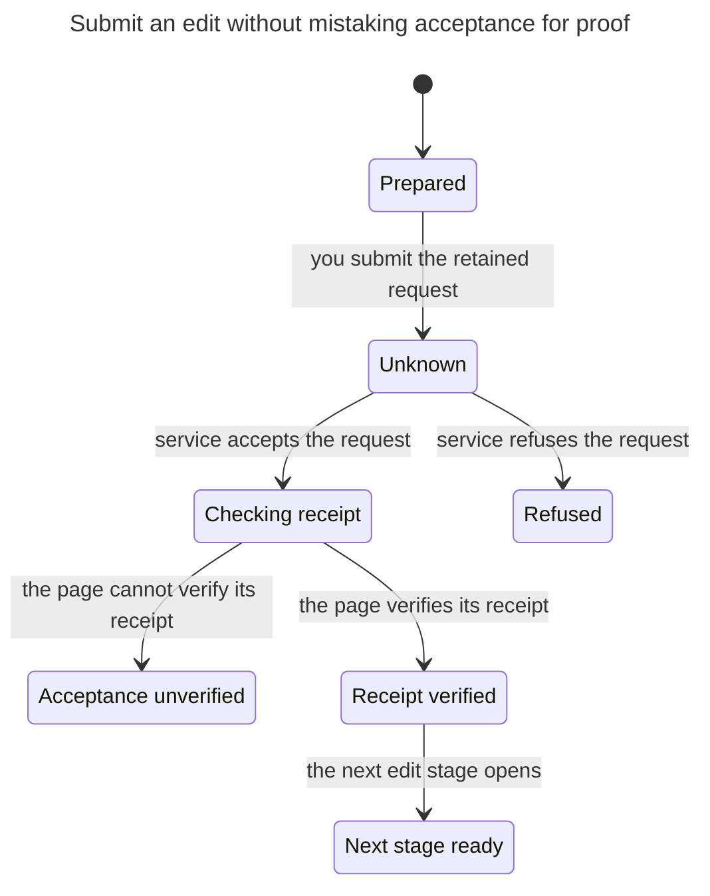
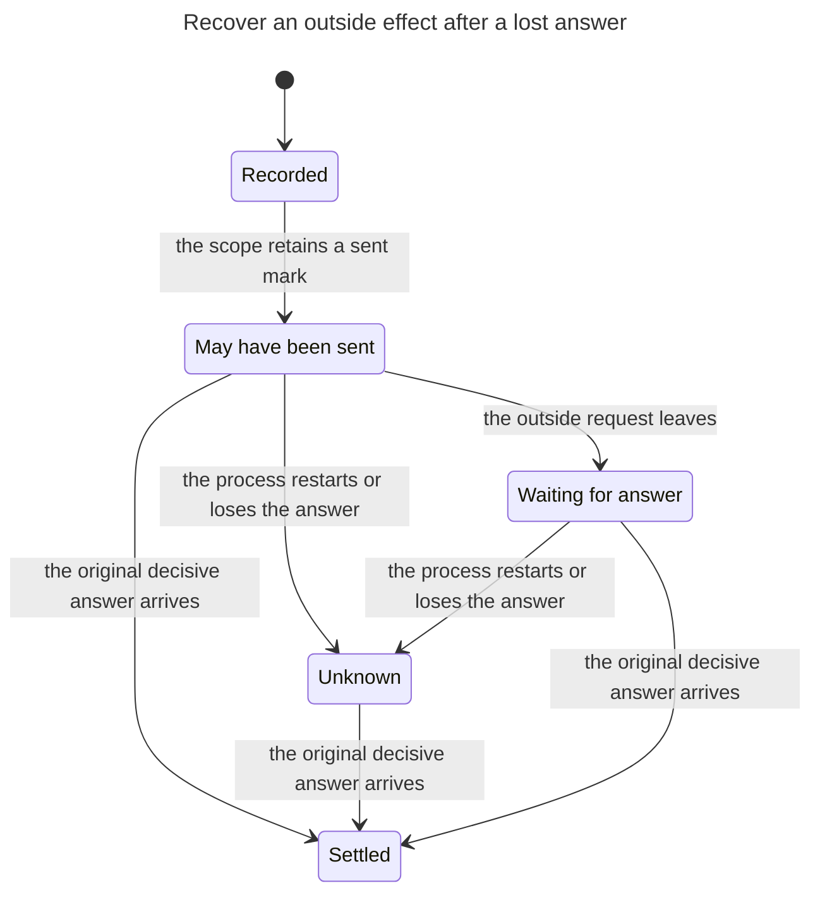
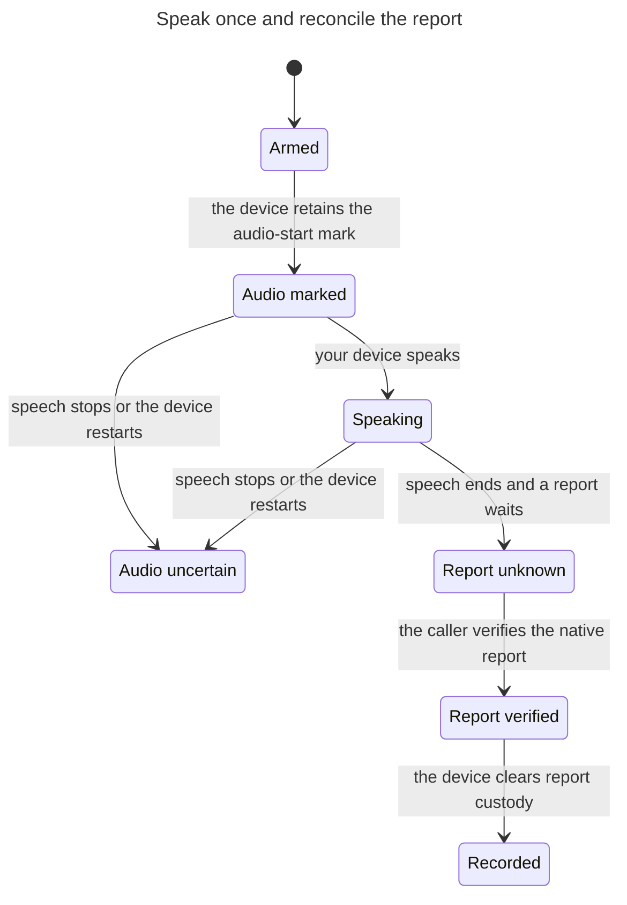

# Verify the five priority state machines

The corrected Editor chart and targeted checks pass after published M0 main `f2677f77`. Editor includes failed receipt verification and checks seven states. Its model fault fails the intended invariant. The reconciled Effects check and source control pass, and scratch preflight cases prove that dirty or unreadable Git state stops the control before baseline execution. The original failed gate and the failed preflight wrapper remain failed. The final maintained gate passes at `cb5d7d70`, with actual `gate.exit` 0 read. Renewed review remains due. Editor and Effects counts follow the corrected checks; Transport, Observation and Voice retain their original checked counts at `13e704a47a`.

The 7 November survey lives in gitseq request `a99e32d9` at `attachments/full-report` and `attachments/priority-list`. It audited `e50d9eebb27f47d0f33549486751ab8bdce8de80`. This verification follows the five-item shortlist, not the full inventory. Gitseq request `3c6d197df2db35e3d1603f63acfa63953da7c1a0` tracks this delivery, under promise `5c826d7435eef1e7a2b8df3c7db6efdf94f4654b`.

Transport, observation and voice retain their source at `8faa38dcf31855a0a6264e5912b58061b5eda223`, unchanged through main `f2677f77`. Effects follows the identifier cutover at `99ed4a7e143f`: its check and source control pass on 13 November. Editor now follows `8dc1381c732132be8a6d378697e0b87191bd2801`: its model check, real-source witness and statechart pass on 10 November. The model reaches seven distinct states; the chart shows six arrows and hides three terminal waits. F changes `supports` outside `continueEdit`. Both protected Editor functions match the BR13 bytes. Planner ruling `12c4f5fb` requires no repeated fault control for this unchanged boundary. The [BR13 note](../../notes/implementation/2026-11-09-br13-version-questions.md) records the earlier comparison and results. See the [F implementation note](../../notes/implementation/2026-11-10-canonical-spelling.md) for the 10 November Editor evidence. Each model checks a narrow safety obligation. None proves its entire subsystem.

In the original submission, TLC 1.7.4 exhaustively explored each finite model. All eight safety invariants passed. Deliberately broken transitions failed every invariant. Five deliberate source faults failed the corresponding source assertions, and the restored source passed. These controls establish that the checks can fail; they do not establish refinement of TypeScript by TLA+.

The finite-model invariants mostly restate the guards in those models. They provide review checklists and diagrams; the real-source witnesses provide regression protection. Neither establishes refinement of the implementation.

| Subsystem | Model states | Safety obligation | Project skill |
|---|---:|---|---|
| MCP transport | 5 | A late factory cannot revive a retired generation. | [verify-mcp-transport](../../.agents/skills/verify-mcp-transport/SKILL.md) |
| Client observation | 4 | An obsolete observer cannot repaint the current view. | [verify-client-observation](../../.agents/skills/verify-client-observation/SKILL.md) |
| Retained editor | 7 | Acceptance alone cannot advance an edit. | [verify-retained-editor](../../.agents/skills/verify-retained-editor/SKILL.md) |
| Outside effects | 7 | Each attempt sends at most once, after its durable mark. | [verify-outside-effects](../../.agents/skills/verify-outside-effects/SKILL.md) |
| Counter voice | 8 | Speech follows a durable mark, never replays that turn, and report custody needs proof before clear. | [verify-counter-voice](../../.agents/skills/verify-counter-voice/SKILL.md) |

## Run a subsystem check

Use the project skill for the subsystem. Reserve the single validation slot and use a dedicated worktree. Never run `check.mjs` or `control.mjs` from the shared checkout at `~/play/artroom`. Run no other validation or builds during that interval. Keep the checked worktree's source fixed, except for the control's recorded fault and restoration. Set `TLA2TOOLS` to the pinned TLA+ tools release 1.7.4 artifact and `JAVA` to a Java executable. The artifact hash starts `936a2620`; its TLC component reports version 2.19. The runner verifies the full SHA-256 before it starts. The recorded environment used Temurin 25.0.5 and one TLC worker.

```sh
node verification/state-machines/check.mjs Editor
```

Choose `Transport`, `Observation`, `Editor`, `Effects` or `Voice`. The runner rejects source drift, checks the model in a fresh scratch directory, then exercises the actual source. It requires the repository's existing dependencies and installs nothing. Source witnesses use deterministic stand-ins except Effects, which runs T19 against a real scope with a stand-in outside port.

For diagrams, use `/statechart` with a scratch copy of the selected model, its config and `view.mjs`, and a new output folder. The skill supplies the current command. Render `chart.mmd` with Pele 1.9.0. Each SVG below comes from the checked model's generated Mermaid text.

To repeat one source fault, run `control.mjs` with a subsystem and a new external evidence directory. Read `controls.json` first. Never run a control while another process edits that source. The script refuses a dirty checkout or a failed Git status before it creates evidence or runs a baseline. It then checks the baseline, changes one guard or dispatch, restores the exact original bytes, and checks the restored source. Inspect the failure assertion: an exception from another guard, a timeout or a missing test proves nothing.

```sh
node verification/state-machines/control.mjs Editor "$HOME/play/artroom-evidence/$(date +%Y%m%d-%H%M%S)-editor-control"
```

## Match model actions to source

| Model actions | Source boundary | Atomicity assumption |
|---|---|---|
| Transport `FactoryReturns`, `Retire`, `LateFactoryDisposed` | `HttpGeneration.open`, `#discard`, and `graceful` | Retirement changes the owner before awaiting cleanup. The factory return checks that owner before opening. Disposal completion abstracts resource cleanup. |
| Observation `Invalidate`, `ReadReturns`, `Discard` | `ObservationConnection.cancel`, `RefreshCoordinator.check` and `read`, and the guarded `emit` callbacks | JavaScript checks and publication run synchronously. The snapshot await separates request from return. Invalidation represents loss of view ownership or cancellation. |
| Editor `Attempt`, `Accept`, `Verify`, `VerificationFailed`, `Advance`, `Refuse` | `transitionEdit` result cases | Each reducer call changes one value synchronously. The executor supplies receipt-verification evidence separately. |
| Effects `Mark`, `Send`, `Restart`, `LateAnswer` | `Operations.#pass`, `#send`, `#answer`, `#offer`, and SQLite `markSent` | The durable mark precedes the queued outside call. Restart loses the local dispatch closure. The model admits a matching late answer conservatively even when it cannot tell whether the call left. |
| Voice `SaveStart`, `Speak`, `Interrupt`, `Complete`, `VerifyReport`, `Clear` | `start`, `stopAudio`, restoration in `ready`, and `settle` | `SaveStart` represents successful durable write and exact readback. Interruption after persistence but before playback keeps uncertainty. Verified reporting abstracts the reporter's proof checks. |

## Scope and evidence

The source hashes detect drift. They do not prove that a handwritten model matches the implementation. Each skill names the functions that require review when source changes. Move its sync commit and hashes only after that review and the affected checks pass.

Each model permits stuttering only at its modeled terminal states. TLC also checks active phases for deadlocks. Unresolved audio custody counts as terminal in this slice because native pledge resolution lies outside it. No fairness or liveness property claims that external work eventually completes. The diagrams hide stuttering and transitions between model states that share a visible label. They show every visible user choice in these bounded slices. No current product bug emerged from these checks.

The source faults demonstrated five concrete failures: a late factory reopened a retired generation; an old observer emitted cancellation into a new view; an accepted but unverified edit advanced; one marked attempt dispatched twice; and an audio restart allowed arming despite retained custody. These are deliberate faults, not findings against the original source.

The first Transport source control removed an `if` but left its `else`, so it failed to parse. A repeat overlapped the gate and caused the security-settings Node owner to fail. The corrected control uses `if (true)`, reaches the expected revival assertion, and restores the source. The control runner now requires the named assertion as well as exit 1. The gate failure remains in the evidence; recovery runs only the affected Node owner and previously unreached stages.

The first Voice command selected Vitest instead of its Node test owner and ran no tests. The corrected Node command passed. The first Effects fault hit SQLite's second sent-mark guard, so it did not prove the duplicate-dispatch assertion. The replacement fault dispatched twice and failed the expected attempt-list assertion. The evidence retains both inconclusive runs.

See the [implementation note](../../notes/implementation/2026-11-08-formal-state-machines.md) for the gate outcome and evidence manifest. Raw checker output, control logs and counterexample reports stay outside the checkout.

## Connect an agent and retire its transport

One generation and one pending factory. Retirement abstracts detach, abrupt discard and graceful close only for the no-revival property. It does not prove row retention, stream capacity, deadlines or OAuth authorization.

[SVG diagram](Transport/chart.svg) · [TLA+ model](Transport/Transport.tla)



## Read a room and leave while its snapshot loads

One read and one cancellation. A successful read represents a complete, context-matching snapshot. Authentication, reconnect backoff, head conflicts and coalesced refresh are outside this property.

[SVG diagram](Observation/chart.svg) · [TLA+ model](Observation/Observation.tla)



## Submit an edit without mistaking acceptance for proof

One request step. Repeat this obligation at opening, rules, source and manifest stages. Receipt verification is a trusted input from the network executor. This model does not prove signatures, workflow stage order, reload persistence or source contents.

[SVG diagram](Editor/chart.svg) · [TLA+ model](Editor/Editor.tla)



## Recover an outside effect after a lost answer

One opened attempt, two possible send counts, arbitrary restarts. Mark and dispatch are separate actions. Durable storage survives restart; in-memory permission does not. Safe recovery reads, additional attempts, selection, parked scans and retained-reply paging are outside this model. A decisive answer must authenticate the exact original attempt. Send counts calls from Operations to its outside port, not provider-internal retries.

[SVG diagram](Effects/chart.svg) · [TLA+ model](Effects/Effects.tla)



## Speak once and reconcile the report

One armed turn, two possible playback counts, one report. Storage succeeds, the lock serializes custody, and verified report proof is trusted. Audio interruption remains uncertain. Native pledge resolution, corrected requests, token-memory capacity and browser speech-engine behavior remain outside the model. Restart covers unresolved audio custody. After a verified report clears custody, this model assumes fresh authenticated observations cannot reoffer the fulfilled turn.

[SVG diagram](Voice/chart.svg) · [TLA+ model](Voice/Voice.tla)


